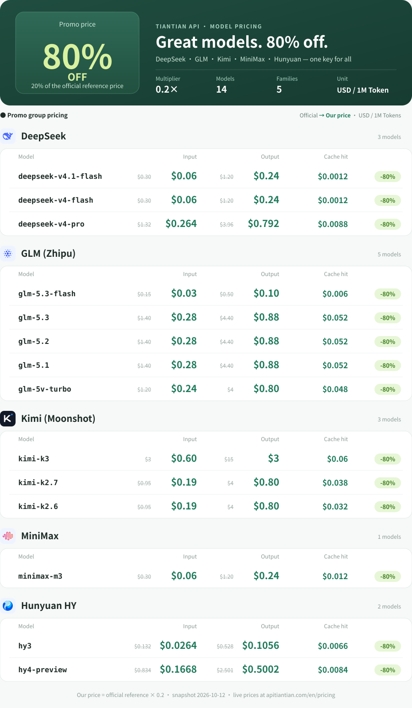

<p align="center">
  
</p>

<p align="center"><a href="README.md">简体中文</a> · <b>English</b></p>

# Tiantian API · Chinese LLM APIs at 80% OFF

**DeepSeek API · GLM API · Kimi API · MiniMax API · Hunyuan API — every model billed at 20% of the official price**

<p align="center"><a href="https://apitiantian.com/en/pricing"></a></p>

One API key for DeepSeek, GLM, Kimi, MiniMax and Hunyuan, through **OpenAI Chat Completions**, **OpenAI Responses** and **Anthropic Messages** compatible endpoints — **Claude Code, Codex, CC Switch, OpenCode** and the OpenAI SDK work out of the box. Built for AI coding, agents and app development.

- 💰 **80% off official prices**: promo group multiplier 0.2 on every model — DeepSeek V4.1 Flash input just **$0.06 / 1M tokens**
- ⚡ **Stable and fast**: independent monitoring by [HVOY AI relay ranking](https://www.hvoyai.com/sites/apitiantiancom/) (2026-10-12) shows **100%** uptime and **3240 ms** average latency, user rating 5/5
- 🔑 **One key for every model**: keep the same key and change `model` to switch between DeepSeek / GLM / Kimi / MiniMax / Hunyuan
- 🛠 **Made for AI coding**: one-click import into Claude Code and Codex via CC Switch; streaming and tool calling supported
- 🧾 **Pay as you go**: input, output and cache tokens billed separately, every request logged in the console

Use Chinese models a lot? [Sign up](https://apitiantian.com/register), start with a small top-up and pay 20% of the official price.

[Website](https://apitiantian.com/en/) · [Model pricing](https://apitiantian.com/en/pricing) · [API guide](https://apitiantian.com/en/guide) · [CC Switch guide (中文)](https://apitiantian.com/guide/cc-switch) · [Sign up](https://apitiantian.com/register) · [Telegram support](https://t.me/Tiantian_api)

## Full price list

USD per 1M tokens. Struck-through = official reference price, bold = Tiantian API price (official reference × 0.2). Snapshot of the public price catalog on 2026-10-12; **see [live pricing](https://apitiantian.com/en/pricing) for current rates.**

<details>
<summary><b>Text price table (easy to copy and search)</b></summary>

| Family | Model ID | Input | Output | Cache read (ours) |
| --- | --- | --- | --- | --- |
| DeepSeek | `deepseek-v4-flash` | ~~$0.3~~ **$0.06** | ~~$1.2~~ **$0.24** | $0.0012 |
| DeepSeek | `deepseek-v4-pro` | ~~$1.32~~ **$0.264** | ~~$3.96~~ **$0.792** | $0.0088 |
| DeepSeek | `deepseek-v4.1-flash` | ~~$0.3~~ **$0.06** | ~~$1.2~~ **$0.24** | $0.0012 |
| GLM (Zhipu) | `glm-5.1` | ~~$1.4~~ **$0.28** | ~~$4.4~~ **$0.88** | $0.052 |
| GLM (Zhipu) | `glm-5.2` | ~~$1.4~~ **$0.28** | ~~$4.4~~ **$0.88** | $0.052 |
| GLM (Zhipu) | `glm-5.3` | ~~$1.4~~ **$0.28** | ~~$4.4~~ **$0.88** | $0.052 |
| GLM (Zhipu) | `glm-5.3-flash` | ~~$0.15~~ **$0.03** | ~~$0.5~~ **$0.1** | $0.006 |
| GLM (Zhipu) | `glm-5v-turbo` | ~~$1.2~~ **$0.24** | ~~$4~~ **$0.8** | $0.048 |
| Kimi (Moonshot) | `kimi-k2.6` | ~~$0.95~~ **$0.19** | ~~$4~~ **$0.8** | $0.032 |
| Kimi (Moonshot) | `kimi-k2.7` | ~~$0.95~~ **$0.19** | ~~$4~~ **$0.8** | $0.038 |
| Kimi (Moonshot) | `kimi-k3` | ~~$3~~ **$0.6** | ~~$15~~ **$3** | $0.06 |
| MiniMax | `minimax-m3` | ~~$0.3~~ **$0.06** | ~~$1.2~~ **$0.24** | $0.012 |
| Hunyuan HY (Tencent) | `hy3` | ~~$0.132~~ **$0.0264** | ~~$0.528~~ **$0.1056** | $0.0066 |
| Hunyuan HY (Tencent) | `hy4-preview` | ~~$0.834~~ **$0.1668** | ~~$2.501~~ **$0.5002** | $0.0084 |

</details>

Official reference prices are maintained in our catalog and may differ by version or billing rule. Context length and availability are listed on the [pricing page](https://apitiantian.com/en/pricing). "OpenAI" and "Anthropic" refer to compatible protocols only; this service does not provide original GPT, Claude or Gemini models.

## Endpoints and base URL

Pick the key group that matches your client's protocol (Chat Completions / Messages / Responses). Within a group, change `model` to switch between the models above.

| Protocol | Endpoint | Typical clients | Base URL |
| --- | --- | --- | --- |
| Chat Completions | `POST /v1/chat/completions` | OpenAI SDK, Cherry Studio and other compatible tools | `https://apitiantian.com/v1` |
| Messages | `POST /v1/messages` | Claude Code | `https://apitiantian.com` |
| Responses | `POST /v1/responses` | Codex | `https://apitiantian.com/v1` |

If your client appends `/v1` automatically, use the site root to avoid `/v1/v1`.

## Quick start

1. [Sign up](https://apitiantian.com/register), open the console and create a key in the group that matches your protocol.
2. Put the key in the `TIANTIAN_API_KEY` environment variable (never commit it, ship it in frontend code or show it in screenshots).
3. Run any example below.

### Chat Completions (OpenAI compatible)

```bash
curl https://apitiantian.com/v1/chat/completions \
  -H "Authorization: Bearer ${TIANTIAN_API_KEY}" \
  -H "Content-Type: application/json" \
  -d '{"model":"deepseek-v4.1-flash","messages":[{"role":"user","content":"Hello, introduce yourself"}]}'
```

```python
from openai import OpenAI
import os

client = OpenAI(base_url="https://apitiantian.com/v1", api_key=os.environ["TIANTIAN_API_KEY"])
resp = client.chat.completions.create(
    model="glm-5.3",
    messages=[{"role": "user", "content": "Explain what an API is in three sentences"}],
)
print(resp.choices[0].message.content)
```

### Responses (Codex and similar)

```bash
curl https://apitiantian.com/v1/responses \
  -H "Authorization: Bearer ${TIANTIAN_API_KEY}" \
  -H "Content-Type: application/json" \
  -d '{"model":"kimi-k3","input":"Explain what an API is in three sentences"}'
```

### Anthropic Messages (Claude Code and similar)

```bash
curl https://apitiantian.com/v1/messages \
  -H "x-api-key: ${TIANTIAN_API_KEY}" \
  -H "anthropic-version: 2023-06-01" \
  -H "Content-Type: application/json" \
  -d '{"model":"glm-5.3","max_tokens":512,"messages":[{"role":"user","content":"Explain what an API is in three sentences"}]}'
```

## Using it with Claude Code, Codex and CC Switch

- **CC Switch**: use "CC Switch import" on the API keys page, pick the target client (Claude Code / Codex) and save — or fill in the endpoint table above manually.
- **Claude Code**: use a Messages-group key, base URL `https://apitiantian.com`, and a model ID from the table (e.g. `glm-5.3`, `kimi-k3`, `deepseek-v4-pro`).
- **Codex**: use a Responses-group key, base URL `https://apitiantian.com/v1`.
- Start a new session after switching models so old sessions don't carry incompatible parameters.

## FAQ

**How does 80% off work?** Our price = official reference price × group multiplier 0.2. Prices on the pricing page already include the multiplier. Input, output and cache reads are billed separately; the console usage log is the billing record.

**401 / 404 / 429?** 401: check the key is complete and in the group that matches the protocol. 404: check for a duplicated `/v1` and that the model ID is in the catalog. 429: lower concurrency and retry with backoff.

**How do I top up?** Balances are in USD — see the [top-up guide (中文)](https://apitiantian.com/guide/payments). Top-ups are non-refundable, so add only what you need.

**Where do I get help?** Documentation issues can be filed in this repository; account, order and balance questions go to [Telegram support @Tiantian_api](https://t.me/Tiantian_api). Never post API keys, passwords or order details in public issues.

---

This repository holds public integration docs and request examples, maintained by the site operator. Prices and available models follow the live data on the website.
