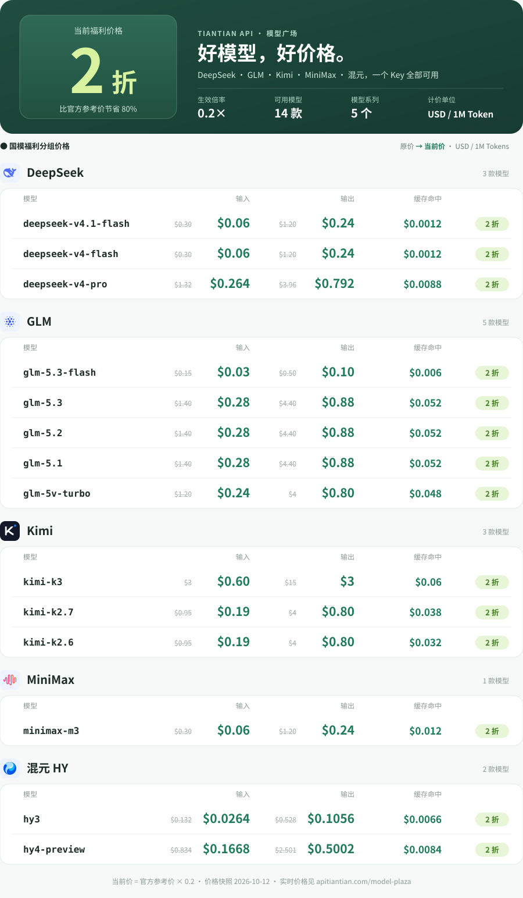

<p align="center">
  
</p>

<p align="center"><b>简体中文</b> · <a href="README.en.md">English</a></p>

# 天天中转站 · 国产大模型 API 官方价 2 折

**DeepSeek API · GLM API · Kimi API · MiniMax API · 腾讯混元 API —— 全部按官方价格的 20% 计费（80% OFF）**

<p align="center"><a href="https://apitiantian.com/model-plaza"></a></p>

一个 Key 调用 DeepSeek、GLM、Kimi、MiniMax、混元等主流国产模型，兼容 **OpenAI Chat Completions**、**OpenAI Responses**、**Anthropic Messages** 三种接口，**Claude Code、Codex、CC Switch、OpenCode** 和 OpenAI SDK 开箱即用。适合日常 AI 编程、智能体任务和应用开发。

- 💰 **官方价 2 折**：国模福利分组倍率 0.2，所有模型统一按官方参考价的 20% 计费，DeepSeek V4.1 Flash 输入仅 **$0.06 / 1M Tokens**
- ⚡ **稳定低延迟**：[禾维 AI 中转站实时排行榜](https://www.hvoyai.com/sites/apitiantiancom/)（2026-10-12）监测在线率 **100%**、平均延迟 **3240 ms**，用户评分 5 分
- 🔑 **一个 Key 通用**：同一分组的 Key 改 `model` 即可切换 DeepSeek / GLM / Kimi / MiniMax / 混元
- 🛠 **为 AI 编程而生**：通过 CC Switch 一键导入到 Claude Code、Codex，支持流式输出与工具调用
- 🧾 **按量计费、透明可查**：输入、输出、缓存分别计价，控制台逐笔记录用量

经常使用国产模型、希望把成本降到 2 折的开发者，可以先[注册](https://apitiantian.com/register)小额体验。

[官网](https://apitiantian.com) · [模型与实时价格](https://apitiantian.com/model-plaza) · [接入教程](https://apitiantian.com/guide) · [CC Switch 教程](https://apitiantian.com/guide/cc-switch) · [注册](https://apitiantian.com/register) · [Telegram 客服](https://t.me/Tiantian_api) · [English](README.en.md)

## 全部模型价格

单位 USD / 1M Tokens。划线为官方参考价，加粗为本站价格（官方参考价 × 0.2）。数据取自 2026-10-12 的公开价格目录，**最新价格以[模型广场](https://apitiantian.com/model-plaza)为准**。

<details>
<summary><b>文字版价格表（便于复制和搜索）</b></summary>

| 系列 | 模型 ID | 输入 | 输出 | 缓存读取（本站） |
| --- | --- | --- | --- | --- |
| DeepSeek | `deepseek-v4-flash` | ~~$0.3~~ **$0.06** | ~~$1.2~~ **$0.24** | $0.0012 |
| DeepSeek | `deepseek-v4-pro` | ~~$1.32~~ **$0.264** | ~~$3.96~~ **$0.792** | $0.0088 |
| DeepSeek | `deepseek-v4.1-flash` | ~~$0.3~~ **$0.06** | ~~$1.2~~ **$0.24** | $0.0012 |
| GLM（智谱） | `glm-5.1` | ~~$1.4~~ **$0.28** | ~~$4.4~~ **$0.88** | $0.052 |
| GLM（智谱） | `glm-5.2` | ~~$1.4~~ **$0.28** | ~~$4.4~~ **$0.88** | $0.052 |
| GLM（智谱） | `glm-5.3` | ~~$1.4~~ **$0.28** | ~~$4.4~~ **$0.88** | $0.052 |
| GLM（智谱） | `glm-5.3-flash` | ~~$0.15~~ **$0.03** | ~~$0.5~~ **$0.1** | $0.006 |
| GLM（智谱） | `glm-5v-turbo` | ~~$1.2~~ **$0.24** | ~~$4~~ **$0.8** | $0.048 |
| Kimi（月之暗面） | `kimi-k2.6` | ~~$0.95~~ **$0.19** | ~~$4~~ **$0.8** | $0.032 |
| Kimi（月之暗面） | `kimi-k2.7` | ~~$0.95~~ **$0.19** | ~~$4~~ **$0.8** | $0.038 |
| Kimi（月之暗面） | `kimi-k3` | ~~$3~~ **$0.6** | ~~$15~~ **$3** | $0.06 |
| MiniMax | `minimax-m3` | ~~$0.3~~ **$0.06** | ~~$1.2~~ **$0.24** | $0.012 |
| 混元 HY（腾讯） | `hy3` | ~~$0.132~~ **$0.0264** | ~~$0.528~~ **$0.1056** | $0.0066 |
| 混元 HY（腾讯） | `hy4-preview` | ~~$0.834~~ **$0.1668** | ~~$2.501~~ **$0.5002** | $0.0084 |

</details>

官方参考价为本站目录维护值，不同版本及计费规则可能存在差异，详见[计费说明](https://apitiantian.com/guide/billing)。各型号的上下文长度和可用状态见[模型广场](https://apitiantian.com/model-plaza)。OpenAI、Anthropic 在这里指兼容协议，本站不提供 GPT、Claude、Gemini 原厂模型。

## 接口与 Base URL

按客户端使用的协议选择 Key 分组（Chat Completions / Messages / Responses），同一分组的 Key 改 `model` 即可切换上表模型。

| 协议 | 完整端点 | 常见客户端 | Base URL |
| --- | --- | --- | --- |
| Chat Completions | `POST /v1/chat/completions` | OpenAI SDK、Cherry Studio 等兼容工具 | `https://apitiantian.com/v1` |
| Messages | `POST /v1/messages` | Claude Code | `https://apitiantian.com` |
| Responses | `POST /v1/responses` | Codex | `https://apitiantian.com/v1` |

客户端会自动追加 `/v1` 时填站点根地址，避免出现 `/v1/v1`。

## 快速开始

1. [注册](https://apitiantian.com/register)并登录控制台，在 API 密钥页创建对应协议分组的 Key。
2. 把 Key 放进环境变量 `TIANTIAN_API_KEY`（不要写进公开仓库、前端代码或截图）。
3. 运行下面任一示例。

### Chat Completions（OpenAI 兼容）

```bash
curl https://apitiantian.com/v1/chat/completions \
  -H "Authorization: Bearer ${TIANTIAN_API_KEY}" \
  -H "Content-Type: application/json" \
  -d '{"model":"deepseek-v4.1-flash","messages":[{"role":"user","content":"你好，介绍一下你自己"}]}'
```

```python
from openai import OpenAI
import os

client = OpenAI(base_url="https://apitiantian.com/v1", api_key=os.environ["TIANTIAN_API_KEY"])
resp = client.chat.completions.create(
    model="glm-5.3",
    messages=[{"role": "user", "content": "用三句话解释什么是 API"}],
)
print(resp.choices[0].message.content)
```

### Responses（Codex 等）

```bash
curl https://apitiantian.com/v1/responses \
  -H "Authorization: Bearer ${TIANTIAN_API_KEY}" \
  -H "Content-Type: application/json" \
  -d '{"model":"kimi-k3","input":"用三句话解释什么是 API"}'
```

### Anthropic Messages（Claude Code 等）

```bash
curl https://apitiantian.com/v1/messages \
  -H "x-api-key: ${TIANTIAN_API_KEY}" \
  -H "anthropic-version: 2023-06-01" \
  -H "Content-Type: application/json" \
  -d '{"model":"glm-5.3","max_tokens":512,"messages":[{"role":"user","content":"用三句话解释什么是 API"}]}'
```

## 在 Claude Code、Codex、CC Switch 中使用

- **CC Switch**：在本站 API 密钥页使用「CC Switch 导入」，选择目标客户端（Claude Code / Codex）后保存；也可以按上面的接口表手动填写。详见 [CC Switch 配置教程](https://apitiantian.com/guide/cc-switch)。
- **Claude Code**：使用 Messages 分组的 Key，Base URL 填 `https://apitiantian.com`，模型填上表中的模型 ID（如 `glm-5.3`、`kimi-k3`、`deepseek-v4-pro`）。
- **Codex**：使用 Responses 分组的 Key，Base URL 填 `https://apitiantian.com/v1`。
- 切换模型后建议新建会话，避免旧会话携带不兼容的参数。

## 常见问题

**2 折怎么算？** 本站价格 = 官方参考价 × 分组倍率 0.2，模型广场展示的价格已经乘过倍率，无需再算。输入、输出、缓存读取分别计价，控制台的使用记录是费用核对依据。

**401 / 404 / 429？** 401 检查 Key 是否完整有效、分组是否与协议匹配；404 检查地址是否重复拼接 `/v1`、模型 ID 是否在目录中；429 降低并发并退避重试。

**怎么充值？** 站内余额以 USD 计价，见[充值与到账说明](https://apitiantian.com/guide/payments)。不支持退款，请按需充值。

**在哪里反馈？** 文档问题可在本仓库提 Issue；账号、订单、余额问题请联系 [Telegram 客服 @Tiantian_api](https://t.me/Tiantian_api)。公开 Issue 中请勿提供 API Key、密码或订单资料。

## English

Tiantian API: Chinese LLM APIs — DeepSeek, GLM, Kimi, MiniMax and Hunyuan — at **only 20% of official prices**, with one key and OpenAI / Anthropic compatible endpoints for Claude Code, Codex and CC Switch. Full English README: [README.en.md](README.en.md).

---

本仓库为公开接入文档与请求示例，由站点运营方维护。价格与可用模型以官网实时数据为准。
